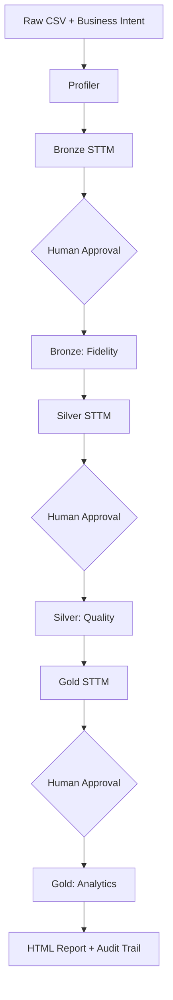

# IDAMP

Intent-driven agentic analytics through a governed Bronze-Silver-Gold medallion pipeline. The system converts raw CSV data and a business question into traceable analytical artifacts.

## Run

```bash
pip install -r requirements.txt
streamlit run app.py
```

Configure `API_KEY` in `.env`. A CLI entry point is available via `orchestrator.py`.

```bash
python orchestrator.py --files raw_files/*.csv --intent "Top revenue-generating products"
```

## Pipeline



## Layers

- **Bronze:** preserves source fidelity, applies controlled type casting, and records load metadata.
- **Silver:** standardizes dates and categories, handles nulls, removes duplicates, and adds surrogate keys.
- **Gold:** performs analytical joins, filtering, aggregation, ranking, and business-intent resolution.

Each STTM is reviewable and editable at a Human-in-the-Loop gate before execution. LLMs formulate mappings and SQL; DuckDB executes transformations deterministically, with fallbacks and JSONL audit logging throughout.

Generated artifacts are stored under `data/`: profiles, STTMs, layer Parquet files, HTML reports, and audit logs.
